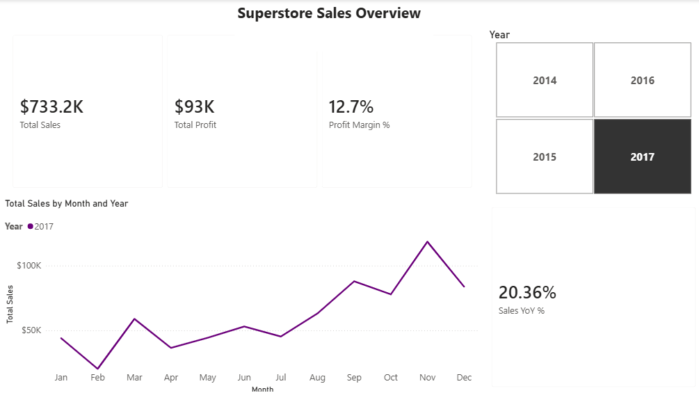
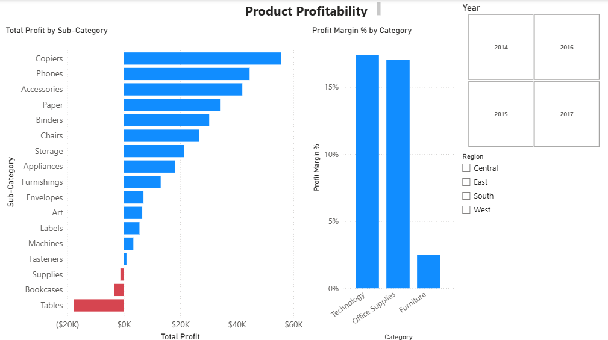
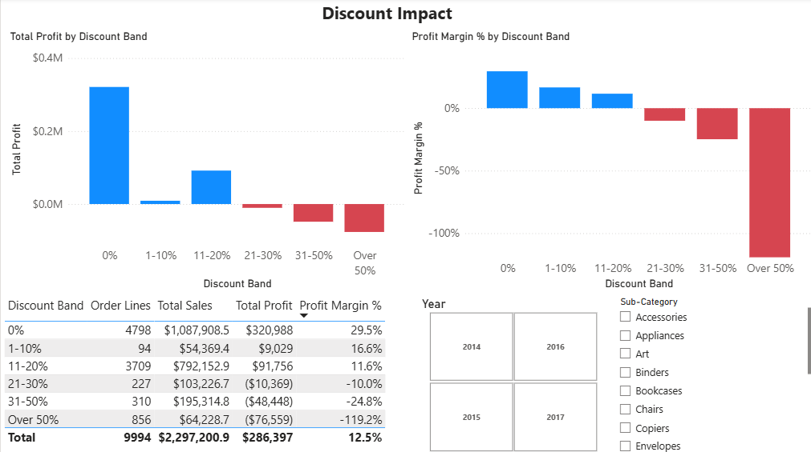
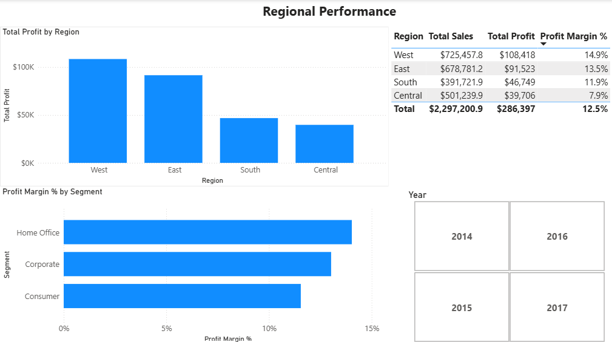

# Superstore Sales & Margin Dashboard

Power BI dashboard analysing where a retail business makes and loses money, and how discounting affects profit.

## Business questions
1. Where does the business make and lose money (by category and sub-category)?
2. Do discounts hurt profit?
3. Which regions or segments should the business focus on?

## Data
Superstore Dataset (Kaggle, by vivek468): 9,994 order lines, 2014-2017, covering sales, profit, discount, category, region and segment. Source: https://www.kaggle.com/datasets/vivek468/superstore-dataset-final

## Tools
Power BI Desktop, Power Query, DAX

## Approach
1. **Cleaning (Power Query):** the file uses US-style dates (month/day/year), so I converted the date columns using the US locale to avoid silent day/month swaps. Checked column types and row count (9,994).
2. **Data model:** built a Date table with Year, Month and Month Number columns, marked it as the date table and linked it to the orders table (one-to-many).
3. **DAX measures:** Total Sales, Total Profit, Profit Margin %, Sales PY, Sales YoY %, Order Lines.
4. **Calculated columns:** Discount Band (0%, 1-10%, 11-20%, 21-30%, 31-50%, Over 50%) with a sort-order column.
5. **Report:** four pages (Overview, Products, Discounts, Regions) with a Year slicer on each.

## Key findings
- **Overall:** $2.30M sales, $286K profit, 12.5% margin.
- **Products:** Tables, Bookcases and Supplies are loss-making sub-categories. Tables lose the most (about $18K). Furniture has a 2.5% margin, against about 17% for Technology and Office Supplies.
- **Discounts:** profit falls as discounts rise. Lines with no discount earned a 29.5% margin and $321K profit, while lines discounted 21-30%, 31-50% and over 50% had margins of -10.0%, -24.8% and -119.2%.
- Order lines discounted over 20% were about 14% of all lines but lost about $135K combined, while all other lines earned about $422K.
- **Tables:** profitable at 0% discount (18.5% margin) but heavily loss-making at 31-50% discounts (-42.1% margin), so much of the loss on Tables is linked to discounting.
- **Regions:** West ($108K profit, 14.9% margin) and East ($92K, 13.5%) lead. Central makes more sales than South ($501K vs $392K) but less profit ($40K vs $47K), with the lowest margin at 7.9%.
- **Segments:** margins are similar, with Home Office highest (about 14%) and Consumer lowest (about 11.5%).

## Limitations
- The data shows discounts are associated with losses, not that discounts alone cause them. Product mix and region may also play a part.
- Some bands are small (the 1-10% band has only 94 order lines), so I avoided strong conclusions there.

## Recommendations
- Review the discount policy for discounts above 20%, especially on Tables and Bookcases.
- Investigate why Central's margin is much lower than other regions.

## Screenshots

